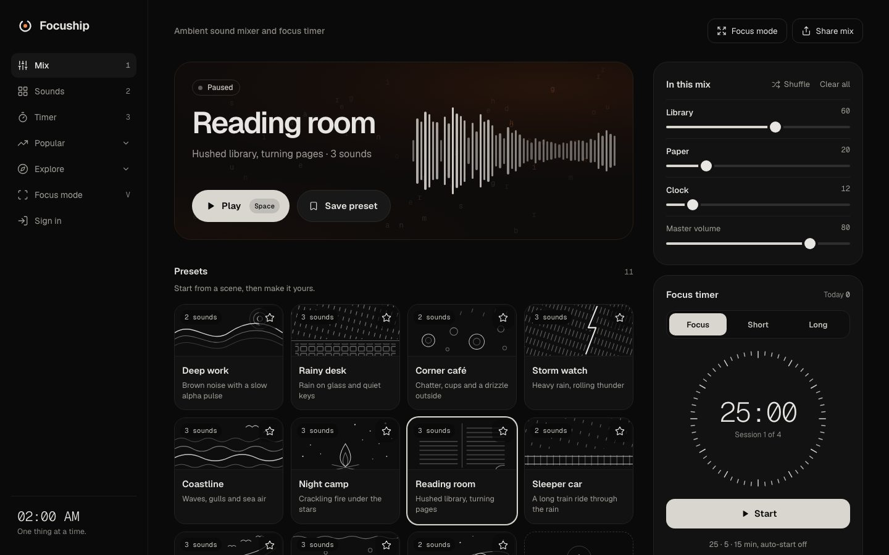
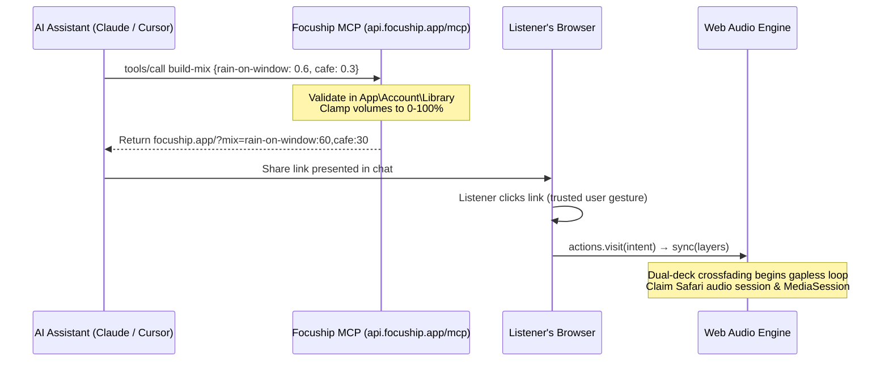

# Case study: Focuship

**An Ambient Sound Mixer PWA and OAuth MCP Server in 8 Days**

Between 20 and 28 October 2026, I architected and built [Focuship](https://focuship.app): a mobile-first ambient sound mixer and focus timer that runs offline as a Next.js PWA, paired with a custom Laravel backend and a Model Context Protocol (MCP) server for AI assistants. I authored **all 47 commits** on the repository, pairing with Claude Code across 36 commits and 5 merged pull requests.



| | |
|---|---|
| **Role** | Architect & Full-stack Engineer, paired with Claude Code |
| **Team** | 1 developer, 1 monorepo (Next.js 15 PWA + Laravel 11 API) |
| **Window** | 20 to 28 Oct 2026 (Asia/Dhaka) |
| **Milestone** | Production launch on `focuship.app` (Cloudflare Edge + cPanel API) |
| **Stack** | Next.js 15, Web Audio API, TypeScript, Laravel 11, Tailwind CSS, Playwright, Vitest, Pest |

---

## The days (20 to 28 Oct)

The development unfolded in two planned milestones. The first milestone (20 to 22 October) delivered the client application: a high-performance Next.js PWA deployed to Cloudflare's edge with 64 audio sources, programmatic SEO landing pages, research guides, and a complete dark-ember visual redesign. The second milestone (22 to 28 October) built the backend infrastructure: a dedicated Laravel API providing Sanctum session authentication, account synchronization, and an OAuth 2.1 Model Context Protocol server for AI assistants.

```
Commits per day (20 to 28 Oct 2026):
20 Oct: ███████████████████████ 23 commits (Audio engine, PWA, SEO foundation, 6 guides)
21 Oct: ███████████ 11 commits (Push-state routing, accounts, OAuth consent)
22 Oct: ██████████ 10 commits (Ember visual redesign, 4-tier test harness)
23 Oct: ██ 2 commits (Laravel API cutover, OAuth 2.1 MCP server)
24-27 : (quiet in production)
28 Oct: █ 1 commit (MariaDB schema timestamp defaults)
```

**Totals:** 47 of 47 commits on `main`, 36 paired with Claude Code, 5 of 5 merged pull requests, 38 GitHub issues closed, 5 architectural decision records (ADRs) accepted.

---

## The brief

Focuship was built to be a daily workspace tool: a distraction-free ambient mixer and Pomodoro timer that starts immediately and stays out of the user's way. The project had five core non-negotiables:

1. **Zero-latency, gapless audio:** Sound layers must start synchronously on a user gesture, crossfade smoothly without audible loop seams or boundary clicks, and stay playing when the phone is locked.
2. **Static edge architecture:** The web application must prerender to plain static HTML (`output: "export"`) and deploy as a Cloudflare Worker asset with zero server rendering overhead.
3. **True offline operation:** Audio files fetched once must be cached locally by a service worker and play without network access.
4. **Frictionless guest experience:** No login wall. All 64 sounds, timers, presets, and share links work without an account. Accounts remain strictly optional.
5. **Verifiable science:** Every research guide covering noise colors, binaural beats, and ADHD focus must cite peer-reviewed papers with verified DOIs, making zero unsubstantiated medical claims.

---

## System architecture

Focuship operates as a decoupled system. The client frontend is a statically exported Next.js Progressive Web App distributed across Cloudflare's global edge network. State management uses a module-level external store read through `useSyncExternalStore`, while audio runs in a dedicated Web Audio engine using dual-deck crossfading. For signed-in listeners and AI agents, the frontend connects to a Laravel 11 API hosted on cPanel behind Cloudflare.

```mermaid
flowchart LR
    subgraph Edge ["Cloudflare Edge (focuship.app)"]
        HTML["Static Next.js App Shell\n(out/)"]
        SW["Service Worker\n(sw.js · Offline Cache)"]
        Audio["Web Audio Engine\n(dual-deck crossfade · drone synthesis)"]
    end

    subgraph API ["Laravel 11 API (api.focuship.app)"]
        Sanctum["Sanctum SPA Auth\n(cookie session · Brevo SMTP)"]
        Library["App\\Account\\Library\n(presets · caps · settings)"]
        MCP["Passport OAuth 2.1 MCP\n(16 tools · RFC 8414 PKCE)"]
        DB[("MySQL / MariaDB")]
    end

    subgraph Client ["Client & Agents"]
        Browser["Listener's Browser\n(Gesture-started audio)"]
        Agent["AI Assistants\n(Claude · Cursor)"]
    end

    HTML --> Browser
    SW --> Browser
    Browser --> Audio
    Browser -. Sanctum Cookie .-> Sanctum
    Sanctum --> Library
    Agent -. OAuth 2.1 JSON-RPC .-> MCP
    MCP --> Library
    Library --> DB
```

- **Static export seam:** Builds to `out/` with `output: "export"`. No runtime server headers or dynamic SSR; headers and caching rules live in `public/_headers`.
- **Dual-deck audio engine:** Each recorded track uses two alternating HTML5 audio decks crossfading 1.5 seconds before boundary edges, eliminating mp3 clicking.
- **Unified Library:** `App\Account\Library` serves as the single authority in Laravel for presets, caps, and settings, preventing drift between the web API and MCP tools.

---

## Day one: Zero-latency audio and PWA foundation (20 Oct)

On 20 October, the project grew from an initial commit into a working PWA deployed on Cloudflare. The first sprint established the audio pipeline, keyboard navigation, and the sound catalogue.

```text
14:43  Initial build of Let Me Focus: mobile-first ambient mixer PWA
16:16  Fullscreen mode, keyboard shortcuts (V/F), and Safari audio session claim
16:52  Static deployment pipeline to Cloudflare
22:18  Rebrand to Focuship with MIT license and per-page offline caching
22:39  Custom sci-fi drone synthesizer and Deep space preset
```

- **Synthesized drone:** A real-time Web Audio graph combining detuned low-frequency oscillators with an LFO-swept low-pass filter and filtered brown noise, producing a continuous starship hum without media files.
- **Readable share links:** Mix configurations serialize in plain text (`?mix=rain-on-window:60,keyboard:30`), avoiding opaque base64 hashes or database lookups for guests.

---

## Programmatic pages with strict quality gates (20 Oct)

Instead of generating hundreds of thin pages, Focuship enforces a programmatic quality gate in `src/lib/pages.ts`. A landing page is only indexable if it provides a curated audio configuration, full editorial copy, FAQs, and validated cross-links. Pages that fail the gate are built for functional use but receive `noindex` and remain excluded from `sitemap.xml` and `llms.txt`.

| Route pattern | Template | Quality gate criteria |
|---|---|---|
| `/sounds/[slug]` | Single sound landing | Curated hero copy, preloaded layer, minimum word count, FAQ |
| `/timer/[duration]` | Preset timer duration | Valid countdown bounds, task advice, related preset mixes |
| `/pomodoro/[work]-[break]` | Interval session | Work/break balance validation, structured Pomodoro guidance |
| `/mix/[slug]` | Curated preset mix | Distinct multi-layer balance, verified layer presence in catalogue |
| `/guides/[slug]` | Evidence-based article | Peer-reviewed research citations with DOIs; manual editorial review |

Wave 1 launched with 27 indexable hero pages, while lower-volume sounds remained safely gated until editorial copy was complete.

---

## Refactoring navigation to native-feeling routes (21 Oct)

Pull request #20 resolved a core user experience friction: tab switches originally changed local component state without modifying the browser URL. Navigating between Mix, Sounds, Timer, and About was refactored to real push-state routes (`/`, `/sounds`, `/timer`, `/about`) without triggering page reloads or interrupting playback.

- **Continuous playback:** The Web Audio engine lives in a persistent module singleton outside Next.js's component tree, preserving audio state across route transitions.
- **5-slot bottom bar:** A mobile navigation bar with an elevated center play/pause button and touch feedback.
- **Swipe-to-dismiss sheets:** Bottom action sheets on mobile support gestural flicking and dismissals matching native platform physics.
- **Keyboard 1-2-3 shortcuts:** Instantaneous tab navigation with keys `1`, `2`, and `3`, automatically suspended when typing in the search bar.

---

## The visual identity: Ember glow and dark surfaces (22 Oct)

Pull request #23 replaced the initial utility appearance with Focuship's dark visual identity. Grounded in near-black surfaces (`#0a0a0a`), warm hairlines (`#1f1f1f`), and an orange ember focal point (`#f08a4b`), the interface minimizes visual fatigue during prolonged deep work sessions.

- **The Mark:** An open timer ring enclosing an ember dot, rendered dynamically in SVG, canvas app icons, and Open Graph card generators.
- **Pill controls:** High-contrast soft-white pills with dark ink glyphs for primary play/save actions, ensuring tap targets exceed 44px.
- **Instant search:** Pressing `/` opens and focuses the sound catalogue search input from any page, returning focus cleanly on Escape.

---

## The backend: A dedicated Laravel API and OAuth MCP server (22–23 Oct)

Focuship was engineered from the start to support both human listeners and AI assistants. While the static Next.js PWA runs autonomously at the edge, accounts and assistant tooling required a dedicated backend. An external BaaS was avoided because the Model Context Protocol requires RFC 8414 dynamic client registration, PKCE OAuth token issuance, and unified domain validation. As recorded in [ADR 0001](../docs/adr/0001-laravel-replaces-supabase.md), I implemented a custom Laravel 11 API in `api/` that powers both web session auth and the MCP server through a single business logic layer.



- **Sanctum session auth:** The web client authenticates via stateful httpOnly cookie sessions scoped to `.focuship.app`, ensuring tokens are never stored in localStorage ([ADR 0003](../docs/adr/0003-sanctum-cookie-sessions.md)).
- **Passport OAuth 2.1 MCP:** The MCP server at `api.focuship.app/mcp` implements RFC 8414 OAuth 2.1 discovery with PKCE, exposing 16 tools, 2 resources, and 1 prompt ([ADR 0004](../docs/adr/0004-mcp-oauth-only.md)).
- **Single catalogue source:** Frontend TypeScript remains the canonical source of truth for all 64 sounds; `npm run export:catalog` writes `catalog.json` for Laravel, and CI fails if they drift ([ADR 0002](../docs/adr/0002-monorepo-api-and-shared-catalog.md)).
- **Browser hand-off guarantee:** The MCP designs and manages; it never triggers audio playback directly. Playback begins exclusively when a human clicks the generated share link, complying with browser autoplay restrictions.

---

## A four-layer test harness with zero hydration errors (22 Oct)

Reliability is verified across four distinct testing layers. Pull request #42 established 660 automated tests, running unit, component, static export, end-to-end, and database API suites before every edge deployment.

| Layer | Framework | Target scope | Tests passing |
|---|---|---|---|
| **Unit & Component** | Vitest + React Testing Library | Store actions, share encoding, UI components, audio stubs | 82 |
| **Static Export Verification** | Vitest (Node) | Prerendered HTML in `out/`, JSON-LD, sitemap, brand rules | 331 |
| **End-to-End Browser** | Playwright (Chromium) | Desktop & Pixel 7 flows, hydration errors, offline caches | 65 |
| **Backend API & MCP** | Pest (PHP against MySQL) | Sanctum sessions, OAuth 2.1 PKCE, 16 MCP tools, rate limits | 182 |
| **Total Test Suite** | | | **660** |

```
Automated test suite expansion (PR #42):
Frontend test coverage:  55 tests ────► 478 tests
Total system tests:      55 tests ───────────────────────────► 660 tests
```

---

## The details a visitor never sees

- **Cloudflare CIDR filtering:** Laravel trusts forwarding headers (`X-Forwarded-For`, `X-Forwarded-Proto`) strictly from Cloudflare's published IP ranges, preventing origin IP spoofing ([ADR 0005](../docs/adr/0005-cpanel-hosting-ssh-deploy.md)).
- **Turnstile-guarded email sign-in:** Passwordless 6-digit login codes require a fresh Cloudflare Turnstile token on every submission, sent via Brevo SMTP to eliminate bot abuse.
- **MariaDB migration safeguards:** Explicit timestamp defaults and InnoDB engine declarations guarantee error-free migrations on shared cPanel hosts with 1000-byte key limitations.
- **Hydration guardrails:** CI Playwright fixtures intercept console errors and immediately fail the build if React logs a hydration mismatch on production prerendered pages.

---

## Architecting with Claude Code

Every line of code and architecture was directed by me, using Claude Code as a fast pair-programming companion. Clear seams and written architectural decision records allowed rapid exploration without losing system coherence.

| I architected & directed | Claude Code drafted & implemented |
|---|---|
| Web Audio engine design with dual-deck crossfade looping | Programmatic page registry and route templates (PR #19) |
| Self-hosted Laravel API architecture and RFC 8414 MCP integration | App shell route navigation and gesture dismissals (PR #20) |
| Sanctum cookie session and Passport OAuth 2.1 security model | OAuth social sign-in and Turnstile email-code flows (PR #22) |
| Visual identity: ember glow theme and token hierarchy | Visual redesign token translation and component refinement (PR #23) |
| Quality gates for programmatic SEO and evidence-based guides | Laravel MCP tool implementations and Pest test matrix (PR #42) |
| cPanel hosting architecture, SSH deploy pipeline, and MariaDB fixes | Static export test suites verifying HTML and metadata |

---

## Where it stands today

- **Live in production:** Deployed at [focuship.app](https://focuship.app) with edge distribution and zero origin compute fees.
- **64 ambient audio sources:** 56 gapless field recordings, continuous synthetic noise generators, and an original real-time starship drone.
- **Live MCP Server:** Operational at `api.focuship.app/mcp`, enabling Claude, Cursor, and custom agents to build and share focus soundscapes.
- **Rock-solid reliability:** 660 automated tests passing across 4 suites with 0 console or hydration warnings.

---

## Where the numbers come from

Commit counts are non-merge commits on `main` between 20 and 28 October 2026, calculated via `git_stats.py` in the Asia/Dhaka time zone. All 47 non-merge commits were authored by Md. Aminur Islam, with 36 commits carrying Claude Code co-authorship trailers. Test numbers are verified from the automated CI test suites recorded in pull request #42 and reproduced locally. Commit counts reflect recorded repository activity, not overall effort.

**Files:**
- [standalone.html](./standalone.html) — Polished standalone single-page HTML artifact with interactive light/dark theme and SVG diagrams
- [case.json](./case.json) — Source document for the case study builder
- [stats.json](./stats.json) — Repository commit and PR metrics
